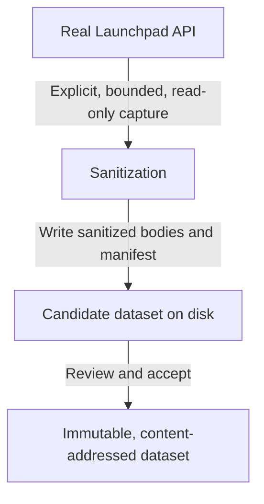
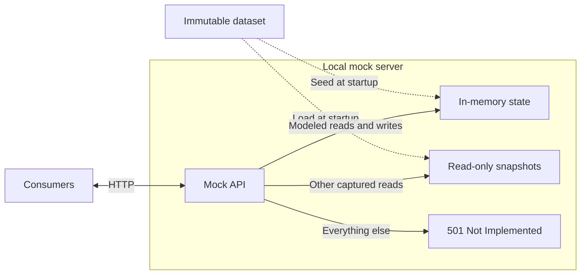

# ADR 0002: A stateful Launchpad mock API seeded from real data

- **Status:** Proposed
- **Scope:** A standalone Launchpad mock layer with captured data and simulated mutations

## Context

Launchpad consumers need realistic data for local development, demonstrations,
and isolated environments. Dummy data can miss real response shapes and
relationships; the live API introduces network dependencies, changing state,
and the risk of unintended operations.

Capture selected real data as reusable datasets and serve it over
Launchpad-compatible HTTP. Consumers should be able to use existing integrations
without requiring a specific client library or mocking API. They need to create and edit
resources, invoke named operations, and read the results—not just receive canned
success responses. Changes must stay local and never modify Launchpad.

This is a service for Launchpad consumers, not TypeScript client test
infrastructure. Client tests may use it but do not define its architecture or
storage format.

## Decision

Provide a standalone HTTP mock in `packages/mock-api/` that captures real data
and serves reads and simulated mutations. It keeps recorded responses as
**snapshots** and loads captured resource objects into mutable
**in-memory state**. Handlers implement **modeled operations** against that state;
other supported reads replay snapshots.

**Capture and review**



**Local serving (no Launchpad access)**



Use immutable datasets, in-memory state, and explicit handlers for a documented
subset of real operations. The server never contacts Launchpad. Prefer the
simplest implementation indistinguishable from Launchpad within that subset;
reject everything else as unsupported.

### Capture selected data from an explicit source

The capture plan lists the API base URL and requests to record. `operationId`
is the operation's name in the upstream OpenAPI description; `bug.get`, for
example, retrieves a bug. `ws.op` is Launchpad's request parameter for named
actions such as `searchTasks`. Select the source explicitly, never defaulting to
production. Keep production, qastaging (Launchpad's test environment), and
local-instance datasets separate.

```json
{
    "source": "https://api.launchpad.net/devel/",
    "limits": { "requests": 100, "pages": 2 },
    "requests": [
        { "operationId": "bug.get", "path": "/bugs/1" },
        {
            "operationId": "project.searchTasks",
            "path": "/launchpad",
            "query": "ws.op=searchTasks&status=New"
        }
    ]
}
```

Capture anonymously, without cookies or credentials inherited from the
environment. Allow only `GET` operations on the tool's read-only allowlist:
`GET` alone does not prove safety. Authenticated capture needs a later decision
on permissions and private data.

Capture sequentially, limit request count and response size, and respect source
rate limits. For pagination, follow only `next_collection_link`, the response
field containing the next page's URL, up to the plan's page limit. Also allow
redirects within the source API: record each redirect response, then capture its
target separately. Never follow redirects automatically or outside the source
API.

A dataset should cover a bounded workflow, such as reading a project and paging
a collection. Coverage is limited to captured requests, not other pages,
filters, or page sizes.

### Persist portable datasets, not client fixtures

Each dataset has a `manifest.json` listing captured requests and responses, and
a `bodies/` directory holding response bodies. Name and reference body files by
their SHA-256 content hashes: the filename also serves as the checksum. This
prevents references outside the dataset without requiring a database. Reject missing
bodies and hash mismatches. The manifest hash identifies the whole dataset.
These are mock runtime data, not client or OpenAPI-generated fixtures.

```text
datasets/launchpad-bugs/
├── manifest.json
└── bodies/
    ├── 0b6f1c…   # SHA-256 of this file's content
    └── 9e2d47…
```

The manifest records:

- Its format version, the source API base URL, the capture time, the
  capture-tool and sanitization-policy versions, and the hash of the OpenAPI
  snapshot that supplied operation IDs.
- Each captured `GET`, in capture order: its operation ID, path relative to the
  source API base URL, and query string, plus the response's status,
  `Content-Type`, `Location`, and body hash.

```json
{
    "format": 1,
    "source": "https://api.launchpad.net/devel/",
    "capturedAt": "2025-06-02T09:30:00Z",
    "captureTool": "0.1.0",
    "sanitizationPolicy": "1",
    "openapiSha256": "4c1a…",
    "requests": [
        {
            "operationId": "project.searchTasks",
            "path": "/launchpad",
            "query": "ws.op=searchTasks&status=New",
            "status": 200,
            "contentType": "application/json",
            "body": "9e2d47…"
        }
    ]
}
```

Store bodies as received after HTTP content decoding, preserving empty bodies,
JSON `null`, unknown fields, and non-JSON error text. Never reconstruct them from
generated types. Binary payloads are outside the initial scope.

Distribute only sanitized, reviewed datasets. Consumers specify the expected
manifest hash at startup; reject a mismatch or unknown format version. Never
execute dataset content as code.

Datasets may be distributed independently of the executable, never in the
client's `schema/`, `src/generated/`, or published package. Neither schema
generation nor startup refreshes them.

### Initialize isolated mutable state

Each process loads one dataset into its own in-memory state. Disk data never
changes; restarting restores the captured state. Durable state and exports of
modified datasets are later extensions, not implicit refreshes.

Load resource objects, called entries, from individual responses and from
`entries`, the array of resources in a collection page. Each object's
`self_link` is its own API URL; use it as the key in the in-memory state and keep
the latest capture for duplicates. Ignore other response shapes:
`branches.getByUrls`, for example, returns a dictionary mapping URLs to branches.

An object's `resource_type_link` points to the API description of its resource
type. For example, `https://api.launchpad.net/devel/#bug` describes a bug
resource. Use the name after `#` to select handlers for that resource type.

Handlers edit a separately parsed copy of the captured JSON, preserving unknown
fields and links without changing snapshots.

```ts
interface Entry {
    self_link: string;
    resource_type_link: string;
    [field: string]: unknown;
}

/** Add the entries in a parsed body; later captures replace earlier ones. */
function collectEntries(
    body: Partial<Entry> & { entries?: Entry[] },
    entries: Map<string, Entry>
): void {
    for (const entry of body.entries ?? [body]) {
        if (entry.self_link) entries.set(entry.self_link, entry as Entry);
    }
}

// "https://api.launchpad.net/devel/#bug" -> "bug"
const entryType = (entry: Entry) => entry.resource_type_link.split("#")[1];
```

Do not assume partial collection pages contain every resource or relationship.
Report operations needing missing data as unsupported rather than inventing
values. Consumers share endpoint state; use separate processes for independent
workflows. Select and reset datasets through process options, not invented
Launchpad routes.

### Serve an independent HTTP interface

Consumers set their API base URL to the mock; no Fetch adapter or TypeScript
dependency is required.

**Routing.** Look up the resource at a path rather than guessing its type from
URL templates. Both `/{project}` and `/{distribution}` match `/ubuntu`, so the
path's shape cannot tell them apart. Upstream OpenAPI lists these as route
alternatives.

Accept the named action's `ws.op` parameter in either the query or POST form
body, as Launchpad does. The TypeScript client sends the first form;
`launchpadlib`, Launchpad's Python client, sends the second with a JSON-encoded
value:

```http
POST /devel/bugs/1?ws.op=newMessage HTTP/1.1
Content-Type: application/x-www-form-urlencoded

content=Thanks
```

```http
POST /devel/bugs/1 HTTP/1.1
Content-Type: application/x-www-form-urlencoded

ws.op=newMessage&content=%22Thanks%22
```

Decode values as JSON when possible, otherwise as strings, matching Launchpad's
API framework, `lazr.restful`. Both requests send the same `content`.

1. Look up the target type from its in-memory entry or modeled collection. Use
   the handler for that type, method, and `ws.op`, if present. Every type has a
   built-in entry-read handler.
2. Otherwise, return a matching snapshot.
3. Otherwise, return the unsupported-request error.

Handlers never fall back to snapshots.

**Reads.** Reading an individual resource returns its current JSON from the
in-memory state, including changes made by supported writes. It does not
replay the captured response. Collections and named operations use a handler
when available, or a snapshot otherwise.

If a supported write can change a read's result, that read must use current
in-memory state rather than a captured snapshot. The server checks this at
startup.

Snapshots use Launchpad's default JSON representation. Reject requests using
`ws.accept`, Launchpad's response-format selector, or an `Accept` header asking
for WADL (an XML API description), XHTML, or HTML-enriched JSON
(`include=lp_html`). These representations are unsupported. Reject datasets
with duplicate snapshots for a request.

**Links.** Rewrite API links so clients following them reach the mock rather
than Launchpad. On load, replace the source API base URL with the configured mock
base in `Location` headers and, during body parsing, fields ending in `_link`,
such as `self_link` and `next_collection_link`. Handlers use that same base,
never the request's `Host`. Leave external URLs unchanged, including `web_link`, which
points to the resource's web page rather than its API endpoint. Reject
`Location` headers pointing outside the source API.

```ts
const parseBody = (body: string, from: string, to: string): unknown =>
    JSON.parse(body, (key, value) =>
        key.endsWith("_link") &&
        typeof value === "string" &&
        value.startsWith(from)
            ? to + value.slice(from.length)
            : value
    );
```

```text
self_link  https://api.launchpad.net/devel/bugs/1  ->  http://127.0.0.1:8080/devel/bugs/1
web_link   https://bugs.launchpad.net/bugs/1       ->  unchanged
```

JSON bodies preserve the captured data except for rewritten API links in `_link`
fields (such as `self_link` and `next_collection_link`). Re-serialization may also
change formatting, so byte-for-byte equality is not guaranteed. Non-JSON bodies
are served unchanged.

**Response marking.** Set `Launchpad-Mock` on every response: `snapshot` for
captures, `in-memory` for computed responses, or `unsupported`. Return
`501 Not Implemented` for unsupported requests. Launchpad's API does not use
this status, so it cannot be confused with a captured error such as a real 404.
Never forward or record requests.

```http
HTTP/1.1 501 Not Implemented
Content-Type: text/plain
Launchpad-Mock: unsupported

No captured or modeled response for GET /devel/launchpad?ws.op=searchTasks&status=Triaged
```

**Deployment and identity.** Default to loopback. Configure one captured person
resource as the acting user for all requests. Ignore credentials; never store
or log them. OAuth, permissions, and cookies are not emulated: accepting a
mutation does not mean Launchpad would allow it.

```sh
launchpad-mock-api serve datasets/launchpad-bugs --sha256 7d3e… \
  --base-url http://127.0.0.1:8080/devel/ --person '~example-person'
```

### Simulate operations, not just successful responses

The mock package explicitly lists the operations it supports. It models
creation, updates, deletion, and named actions only where Launchpad offers them,
rather than exposing a generic CRUD interface.

Operation semantics come from Launchpad's interfaces and server behavior, while
wire formats come from upstream OpenAPI. Behavior is never inferred from names
or HTTP methods, and client-generated contracts are never changed for the mock.

Each mutation defines its inputs and validation, the state it changes, its
response and errors, and the reads it affects. Validation happens before state
changes, and the response uses Launchpad's status and shape. For resource
creation, this includes responses such as `201 Created` with a `Location` header
pointing to the new resource.

This `bug.patch` example supports only description edits:

```ts
export const bugPatch: Mutation = {
    route: "bug PATCH",
    changesReads: ["bug.get"],
    handle(request, mock) {
        const { description, ...others } = request.json();
        if (Object.keys(others).length > 0) return mock.unsupported(request);
        if (typeof description !== "string")
            return mock.badRequest("Invalid description");
        const bug = mock.entries.get(request.resourceUrl)!;
        bug.description = description;
        bug.date_last_updated = mock.clock.tick(); // Launchpad updates this too.
        bug.http_etag = mock.etagOf(bug);
        return mock.respond(209, bug); // lazr.restful's status for PATCH.
    }
};
```

Writes run synchronously, without awaiting, so Node's event loop prevents
partial reads without locks or transactions.

The mock allocates numeric IDs sequentially above the highest captured ID. Its
clock starts at capture time and advances by a fixed step for each write, so the
same requests are repeatable after restart.

The initial implementation ignores the conditional-request headers `If-Match`
and `If-None-Match`, but still updates `http_etag`. This field holds the resource's
HTTP ETag in its JSON response; its value is a hash of the changed content,
rather than the captured ETag.

Modeled collections filter entries from the in-memory state and return them in
Launchpad's collection order. They treat undeclared parameters as unsupported,
and their results cover only in-memory entries, not all of Launchpad.

Pagination uses `ws.start` for the starting offset and `ws.size` for the page
size (default 50, maximum 300). Collection responses always include `total_size`,
the number of matching entries across all pages, as lazr.restful does by default.

```jsonc
{
    "start": 0,
    "total_size": 73,
    "next_collection_link": "http://127.0.0.1:8080/devel/launchpad?status=New&ws.op=searchTasks&ws.size=50&ws.start=50",
    "entries": [
        // 50 bug_task entries from the in-memory state
    ]
}
```

The mock never sends email, triggers builds, publishes packages, or calls
external services. Background operations such as builds, imports, and uploads
are initially unsupported.

## Alternatives considered

- **Hand-written or OpenAPI-generated dummy data:** easy, but loses real examples
  and relationships. May supplement captures later if clearly marked synthetic.
- **On-demand caching proxy:** convenient, but depends on Launchpad and risks
  unexpected requests, changing responses, and stored secrets.
- **Read-only replay or canned writes:** simpler, but reads cannot reflect writes.
- **Complete Launchpad replica:** broader queries and workflows at the cost of
  duplicating server semantics and infrastructure. Prefer bounded simulation.
- **Invalidating snapshots after writes:** allows more captured reads alongside
  writes, but requires tracking affected responses. Modeling those reads keeps
  snapshots static.
- **Typed state per resource:** catches handler mistakes earlier, but requires
  mapping every field and risks dropping unknown ones. Editing JSON preserves
  them.
- **Pseudonymized identifiers:** permits more published resources, but requires
  consistent path, link, and query rewriting. Exclusion is simpler and safer.
- **Client-specific helpers:** useful within applications, but cannot provide a
  shared HTTP endpoint across languages and clients.

## Consequences

Consumers get realistic, reviewable data and local state-changing workflows.
Capture and serving can run in separate environments; serving does not need
source access. The dataset hash, mock version, and in-memory state configuration
make workflows repeatable.

Coverage is limited to captured reads and modeled operations, not arbitrary
queries or Launchpad's web UI. Supporting writes requires replacing affected
snapshots with modeled reads. Maintenance includes operation semantics,
read-after-write consistency, privacy review, dataset freshness, and distribution.
